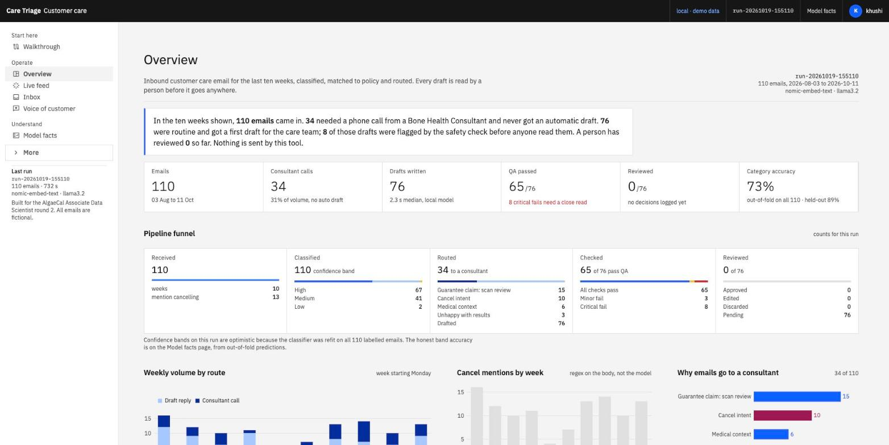
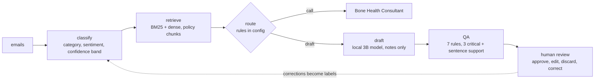
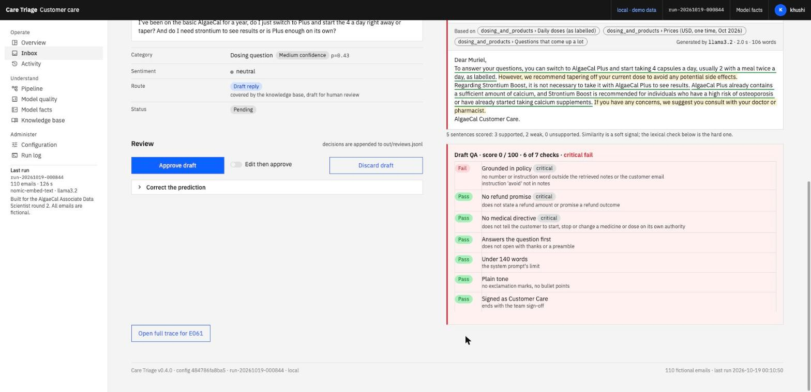
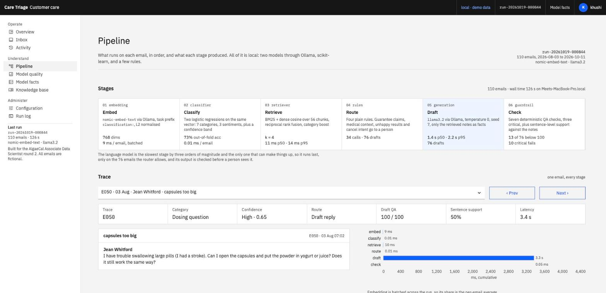
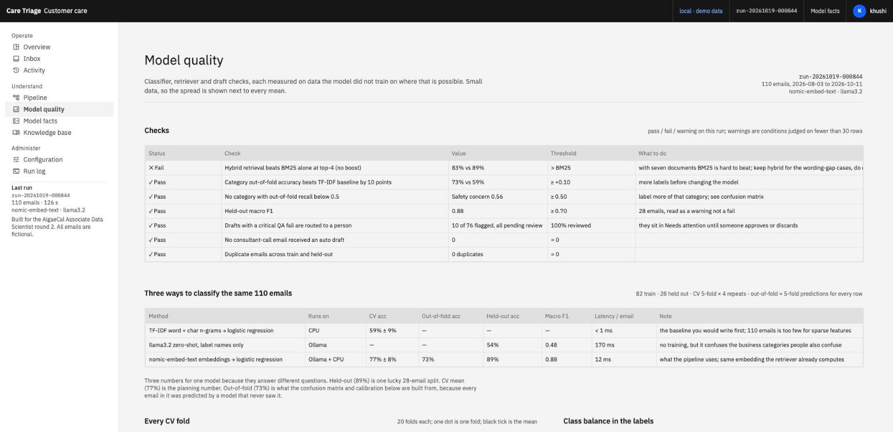
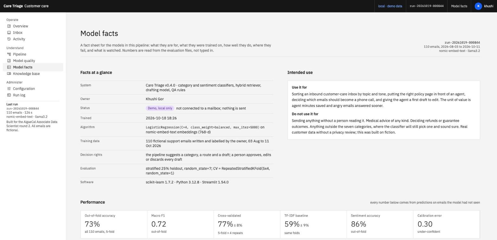
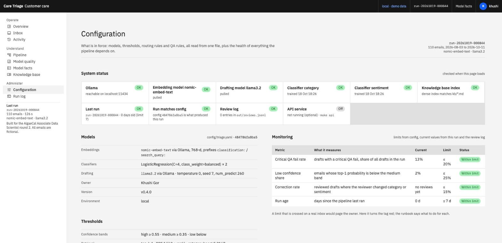

# Customer conversation triage, a demo for AlgaeCal

I built this for the Round 2 video for the Associate Data Scientist role.

At Must IT Services I built an email pipeline for a banking client: inbound emails were classified, scored for sentiment, matched against policy documents with retrieval, and a reply was drafted for an agent to edit. Results went to MongoDB and a Power BI dashboard. I cannot show that code or that data, so this is the same pattern rebuilt from scratch in AlgaeCal's world, on my laptop, in a weekend.

Everything runs locally. No API keys. Ollama provides `nomic-embed-text` for embeddings and `llama3.2` for drafting. The 30 tests run offline, no Ollama needed: `make test`.



What it does to each email, in order: embed it, classify category and sentiment, pull the matching policy paragraphs, decide by rule whether a person should call instead, draft a reply from those paragraphs only, run seven QA checks, and put it in front of a reviewer. Nothing is sent by the system.



## The dashboard

Built like an internal operations product, not a notebook. The visual language is IBM's Carbon Design System (Gray 10 theme, IBM Plex Sans and Mono served locally, square corners, 14px body, 12px labels, one interactive blue, status colours only for status). I went through how Intercom, Zendesk, Gorgias, Langfuse, LangSmith, Phoenix and Evidently lay these things out, and through Carbon's own patterns for data tables, tags, notifications and the UI shell. A fixed header carries the environment, the run id and the reviewer; a left nav has three groups and nine pages.

Operate

- **Overview**: KPI tiles, a pipeline funnel (received, classified by confidence band, routed by reason, QA result, review status), weekly volume, cancel mentions, a Needs attention queue, and why emails go to a consultant.
- **Inbox**: saved views (Needs attention, QA fails, Low confidence, Consultant calls, Pending review, Reviewed), filters, one row per email with band, QA score and review status. Selecting a row shows the email, the prediction, the draft with a provenance banner, sentence-level support highlighting, a seven-check QA scorecard, and the review actions: approve, edit then approve, discard, correct the category or sentiment with a reason. Each decision appends to `out/reviews.jsonl` and raises a toast.
- **Activity**: every review decision, who made it and when, filterable by action and reviewer, with what reviewers corrected and an export. Empty state points back to the Inbox.

Understand

- **Pipeline**: six stage cards with component, p50/p95 latency and counts, then a per-email trace: scores strip, latency waterfall, class probabilities, every retrieved chunk with BM25 and dense rank, the routing rule that fired, the draft with QA, prev/next, raw JSON.
- **Model quality**: a pass/fail/warning check list first, then three classifiers compared, every CV fold as a dot, an out-of-fold confusion matrix, per-class precision and recall, confidence histogram split correct vs wrong, a reliability diagram with ECE, most confident mistakes, retrieval hit@k and MRR, QA pass rate per rule, a faithfulness histogram.
- **Model facts**: a fact sheet in the style of IBM's AI FactSheets. Intended use and out of scope, training data sheet, accuracy by confidence band, per-class numbers, retrieval and generation facts, known failure modes with the evidence for each, a monitoring plan with current values against limits, safety considerations, change history. Every number is read from `models/eval.json` and `out/run.json`.
- **Knowledge base**: the seven documents, which sections get retrieved and which never do, content gaps, and a live search box on the same code path as the pipeline.

Administer

- **Configuration**: system status (Ollama, both models, classifiers, index freshness, run age, whether the run matches the config file, review log, API), the models and thresholds in force, the routing rules as a table with how many emails each one routed, the QA rules with pass rates, the reviewer name, and downloads of every file behind the pages.
- **Run log**: run id, timings, versions, the drafting system prompt, and the stdout of the last run.

Everything configurable lives in one file, `config/triage.yaml`: models, classifier settings, confidence band thresholds, retrieval constants, QA limits, routing rules and monitoring limits. The pipeline, the dashboard and the API read the same object, and the file's hash is stamped into each run so the Configuration page can tell when a run predates a change. The routing rules are data; `tests/test_parity.py` replays the last run through them.

There is also a small FastAPI service (`app/api.py`) over the same code, with `/health`, `/config`, `/emails`, `/emails/{id}`, `/triage` and `/reviews`, so the dashboard is one client of the pipeline rather than the pipeline itself. `tests/` has 30 offline tests (routing, QA rules, retrieval, config validation, API, parity) that run without Ollama. `docs/` has the architecture with a data-flow diagram, a runbook, and five decision records. `CHANGELOG.md` tracks the versions.

No logo or trademark is used anywhere.

| Inbox, reviewing the draft that made something up | Pipeline trace |
|---|---|
|  |  |

| Model quality | Model facts | Configuration |
|---|---|---|
|  |  |  |

## What is in here

```
data/emails.csv          110 support emails I wrote by hand, labelled by me
data/make_emails.py      the emails themselves plus date stamping
kb/*.md                  knowledge base compiled from algaecal.com public pages (Oct 2026)
config/triage.yaml       the one configuration file: models, thresholds, routing rules, QA limits, monitoring limits
app/config.py            loads and validates it, exposes CFG and the file hash
app/classify.py          category + sentiment classifiers, with the honest comparison
app/retrieve.py          BM25 + dense hybrid retrieval over the knowledge base
app/draft.py             routing rules (from config), QA rules, sentence support, local LLM reply drafting
app/pipeline.py          runs every email through, writes out/results.csv, out/trace.jsonl, out/run.json
app/eval_retrieval.py    hit@k / MRR for BM25, dense, hybrid and the boosted pipeline -> models/retrieval_eval.json
app/api.py               FastAPI service over the same code (uvicorn api:app --app-dir app)
app/dashboard.py         Streamlit entrypoint: UI shell, nav, page routing
app/views.py             the nine pages
app/ui.py                Carbon tokens, CSS, Altair theme, data loaders, status checks, small components
app/static/fonts/        IBM Plex Sans and Mono (OFL), served locally
.streamlit/config.toml   Streamlit theme: Carbon colours, Plex font faces, square corners
tests/                   30 offline pytest tests; conftest fakes the embedding call
docs/                    architecture.md (data flow), runbook.md, decisions.md
Makefile                 setup, train, run, eval, all, app, api, test, lint, clean
CHANGELOG.md             versions 0.1.0 to 0.4.0
models/eval.json         holdout + out-of-fold predictions, confusion matrices, fold scores (written by classify.py)
models/retrieval_eval.json  retrieval metrics and the low-evidence email list
out/reviews.jsonl        append-only review log written by the Inbox page and the API (delete it to reset)
out/                     results.csv, trace.jsonl, run.json, pipeline.log from the last run
```

## Run it

```
ollama pull nomic-embed-text
ollama pull llama3.2
pip install -r requirements.txt
python app/classify.py --llm       # ~1 min
python app/pipeline.py             # ~2 min, drafts 76 replies locally, scores them
python app/eval_retrieval.py       # seconds
streamlit run app/dashboard.py
```

Or `make setup`, `make all`, `make app`.

The outputs of the last run are committed (`models/`, `out/`), so the dashboard works straight after `pip install -r requirements.txt` and `streamlit run app/dashboard.py`, with no Ollama and no retraining. Ollama is only needed to rerun the pipeline, for the live search box on the Knowledge base page, and for the API's `/triage` endpoint.

On Windows (tested target: a Ryzen laptop with 16 GB), in PowerShell:

```
winget install Ollama.Ollama            # or the installer from ollama.com; it runs in the tray
py -3.12 -m venv .venv ; .venv\Scripts\Activate.ps1
pip install -r requirements.txt
streamlit run app/dashboard.py          # dashboard only, nothing else needed
ollama pull nomic-embed-text ; ollama pull llama3.2
python app/classify.py --llm ; python app/pipeline.py ; python app/eval_retrieval.py   # full rerun, 5 to 10 min on CPU
del out\reviews.jsonl                   # reset the review log
```

`make` is not installed on Windows by default; use the python commands above instead of the Makefile targets. `make test` runs the offline tests, `make api` starts the service with OpenAPI docs at localhost:8000/docs. Edit `config/triage.yaml` to change a threshold or a routing rule, then `make test` and `make run`.

## What I found

- Three numbers for one classifier, on purpose. Held-out 89% is one lucky 28-email split. Cross-validated 77% is the planning number. Out-of-fold 73% is what the confusion matrix and calibration use, because every email in it was predicted by a model that never saw it.
- The model is under-confident (ECE 0.30, points above the diagonal), which is what class_weight=balanced does on 110 rows. Confidence bands (high ≥ 0.55, medium ≥ 0.35, low) were checked on out-of-fold predictions: 88%, 79%, 52% right.
- With seven short documents, plain BM25 beats the hybrid retriever at top-4 (89% vs 83% on a proxy label). The dense ranks earn their place on wording gaps ("scan got worse" → DEXA page), not on average. The dashboard's check list shows this as a failed check rather than hiding it.
- Seven deterministic QA rules taken from the system prompt catch more than the grounding check alone: 10 of 76 drafts have a critical fail (7 grounding, 2 refund wording, 1 medical directive), 3 more have a minor fail.

- With 110 labels, embeddings + logistic regression (77% cross-validated) beat TF-IDF (59%, and the fold spread is ±9 points either way) and beat llama3.2 zero-shot (54% on the same held-out split). The small supervised model also costs nothing per email.
- The categories that get confused are the ones that are confused for humans too. "My scan didn't change, cancel my subscription" is a guarantee claim, a results question and a cancellation at once.
- The routing rule matters more than the model. Guarantee claims and disappointed-results emails should go to a Bone Health Consultant as a call, not an auto reply.
- Cancel intent rose in the last four weeks of the sample and most of it mentions price. That is a different problem from "no result on scan" and needs a different response.
- The drafts are mostly fine and sometimes confidently wrong. One told a customer that AlgaeCal Plus contains strontium (it does not, Strontium Boost is a separate product). I tried two checks. Scoring every content word against the notes flagged 75 of 76 drafts, useless. Asking llama3.2 to judge its own draft missed the strontium error, flagged sentences copied from the notes, and looped. What is left is a narrow check on numbers and instruction words that are not in the notes. It catches the dangerous class of error, not every error. A person reads every draft.

## What is made up and what is not

The emails are fiction. I wrote them to sound like the customers I read about in AlgaeCal's reviews and forums. The knowledge base is paraphrased from public pages on algaecal.com and is not an official document. The product names, prices and guarantee terms are as published in October 2026. The trend in the "cancel intent" chart is something I planted in the dates when I wrote the dataset, to show what the dashboard would surface if it were real.

## License

MIT. Fonts are IBM Plex under the SIL Open Font License. See `LICENSE`.
