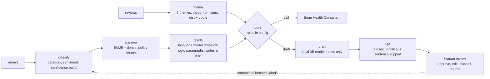
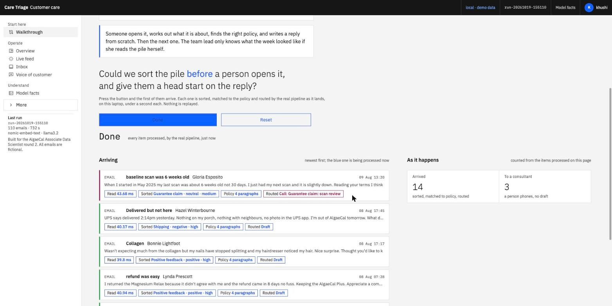
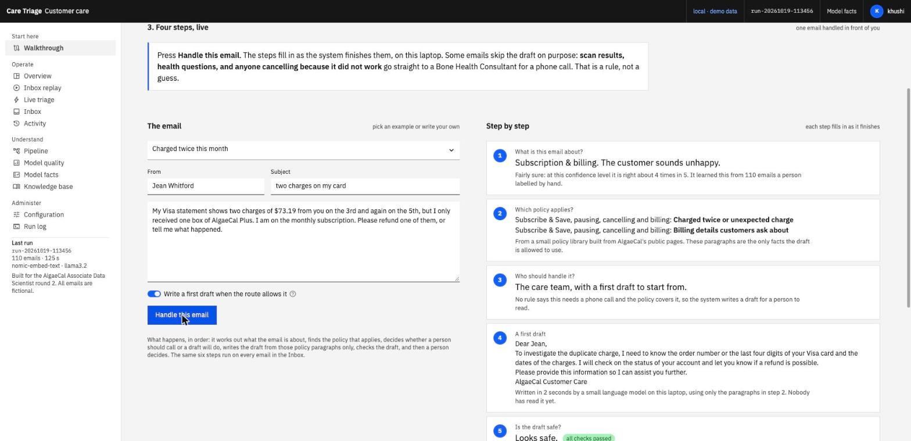
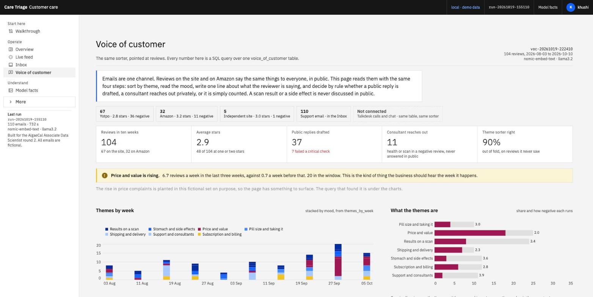
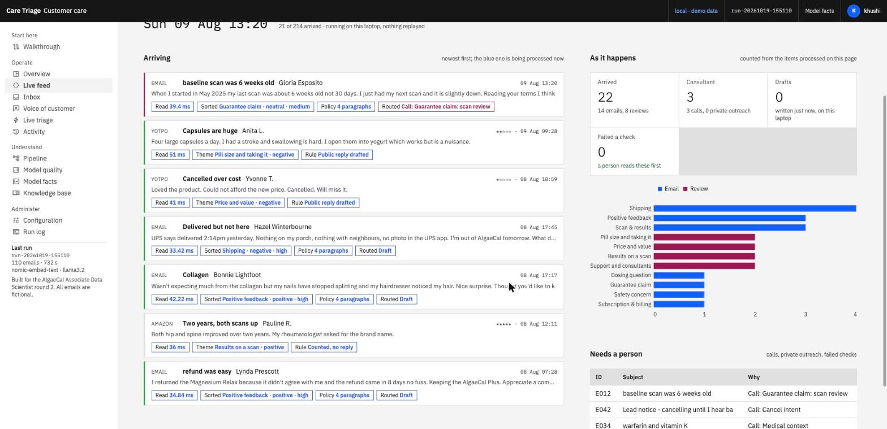
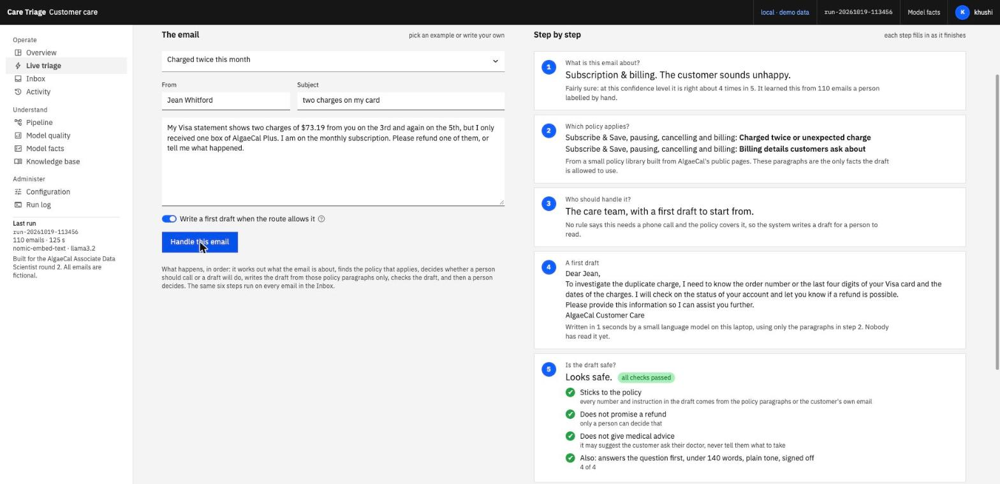

# Customer conversation triage, a demo for AlgaeCal

I built this for the Round 2 video for the Associate Data Scientist role. The video is four minutes, a minute on camera then the Walkthrough page, and the full script, with what is on screen while each line is spoken, is in [the section below](#the-four-minute-video-what-to-show-and-what-to-say) and as a [PDF](docs/presenting.pdf).

At Must IT Services I built an email pipeline for a banking client: inbound emails were classified, scored for sentiment, matched against policy documents with retrieval, and a reply was drafted for an agent to edit. Results went to MongoDB and a Power BI dashboard. I cannot show that code or that data, so this is the same pattern rebuilt from scratch in AlgaeCal's world, on my laptop, in a weekend.

Everything runs locally. No API keys. Ollama provides `nomic-embed-text` for embeddings and `llama3.2` for drafting. The 38 tests run offline, no Ollama needed: `make test`.


What it does to each email, in order: embed it, classify category and sentiment, pull the matching policy paragraphs, have the language model drop the paragraphs that do not answer the email and write a two-line brief, decide by rule whether a person should call instead, draft a reply from the kept paragraphs only, run seven QA checks, and put it in front of a reviewer. Nothing is sent by the system.

The same sorter is pointed at reviews (Voice of customer: seven themes, mood from the stars, a one-line gist with a quoted phrase, a drafted public reply under the same checks, every number a SQL query over one warehouse-shaped table), and a Live feed page lets the emails and reviews arrive one by one with each run through the real pipeline as it lands. In numbers: 110 emails, 104 reviews, 34 consultant calls, 76 drafted email replies of which 8 fail a critical check, 37 drafted public replies of which 7 fail, category accuracy 73% out of fold, theme accuracy 90% out of fold, 38 offline tests.

What is in the app, in the order the sidebar shows it: Walkthrough (the five-stop story the video uses), Overview, Live feed, Inbox, Voice of customer, Model facts, and under More: Live triage, Activity, Pipeline, Model quality, Knowledge base, Configuration, Run log.



## The four-minute video: what to show and what to say

About a minute on camera, then one page of the app, the Walkthrough, which is the page `streamlit run app/dashboard.py` opens on. Five stops, a Next button, one live run. About 517 spoken words: 3:50 at 135 words a minute, 3:59 read slowly to a camera, which leaves room. The shape: who you are and what you build, the bank's inbox, one email and the question, four steps done live, the one the system got wrong, the same sorter on reviews with the SQL behind it, what changed, the honest number, day one.

### Before recording

Once: install the requirements and Ollama, then `ollama pull nomic-embed-text` and `ollama pull llama3.2`.

Every time:

1. Start Ollama. Run `streamlit run app/dashboard.py`. The browser opens on the Walkthrough. Set the browser zoom to 125% and switch on Focus, top right, so the side menu is hidden for the recording.
2. On stop 1 press "Let them arrive" once as a warm-up, so the models are loaded. Press Next to stop 2, keep "Charged twice this month" selected, press "Handle this email" once as a warm-up. The first draft loads the model and is slow. Note how long the draft card takes; that is the pause in Part 3.
3. Delete `out/reviews.jsonl` if it exists and reload, so the review counters start at zero. On stop 1 press Reset under the feed so it is ready to arrive again. Press Back to stop 1.
4. If Ollama is not running, stop 2 says so and the other four stops still work. Say the words anyway and point at the step cards, or open any email in the Inbox and show its steps there.

### Part 1. Who I am, and the bank (0:00)

**Show.** Camera. Look at the lens. Calm, your own pace.

**Say.** Hi, I'm Khushi Gor. I'm an AI engineer, and I've just finished my master's in computer science at Lakehead. Before that I worked at Must IT Services for a year and a half, mostly for clients in finance, building AI they could actually run.

**Say.** The project I'm most proud of was for a banking client. They had an inbox problem: hundreds of emails, every one opened, sorted and answered by hand. I built a system that sorted those emails before anyone opened them, found the policies that applied, and wrote a first draft of the reply. I can't show you that system, so I rebuilt the same idea for AlgaeCal's customer care.


### Part 2. The pile (0:50)

**Show.** Screen. Stop 1. Jean's email on the left. Click "Let them arrive" on "110 other emails" and let them land while you ask the question.

**Say.** Imagine an email from Jean saying she was charged twice this month, and 110 other emails waiting behind it. The question was: could we sort them before someone opens them, and give that person a head start on the reply?


### Part 3. Four steps, live (1:08)

**Show.** Next. Stop 2. Click "Handle this email" as you say it. Point at each card as it fills: sorted, policy, who handles it, draft, check.

**Say.** When I click Handle this email, the system works out what the email is about and how the customer feels. Jean is billing, and unhappy. Then it pulls only the AlgaeCal policies that apply to her email. Then it decides who should handle it. If it's about scan results or someone's health condition, it skips the draft and goes straight to a Bone Health Consultant. Otherwise it writes a short draft from those policies only.

**Say.** I gave the draft rules. It must stay inside AlgaeCal's policies, it must not promise a refund, it must not give medical advice, and it must answer the actual question. And a human makes the final decision. They can approve it, edit it, or throw it away.


### Part 4. The one it got wrong (2:02)

**Show.** Next. Stop 3. Hover the highlighted sentence on "tapering", point at the red Fail row. Slow down.

**Say.** The part I'm most proud of is the time it made something up. Muriel wanted to switch from Basic to Plus, and the draft told her to taper her dose. That is not in any AlgaeCal policy. I'd built a check that asks every sentence of the draft where it came from. That sentence had no answer, so the draft failed, and a person wrote the reply. The system never sends anything on its own.


### Part 5. Your reviews (2:35)

**Show.** Next. Stop 4. Point at the red bars, then the reply card.

**Say.** I pointed the same sorter at a hundred reviews, written to match what AlgaeCal's public ones say. Every number on that page is a SQL query, and in my sample it found price complaints climbing. A bad review about a scan or a side effect never gets a public reply; a consultant calls instead.


### Part 6. What changed, and the honest number (2:59)

**Show.** Next. Stop 5. Four numbers, the accuracy table.

**Say.** What changed: agents get each email sorted with a draft to edit, the team lead sees the whole week on one screen, and the customer gets a reply a person has checked. The honest number: it was right about three times out of four on emails it had never seen. Useful, but not something to trust blindly, so a person always decides.

**Show.** Camera. Stop recording two seconds after the last word.

**Say.** If I joined, on day one I'd work with your consultants to label real emails, because their judgement is what this system needs to learn. Your values say do the right thing even if it hurts. For me, showing you the draft that invented something is exactly that. Thank you for watching.

### Shot list

| Time | On screen | Action |
|---|---|---|
| 0:00 | Camera | Part 1: who you are, what you build, the bank, why this rebuild. About a minute. |
| 0:50 | Stop 1 | Jean's email, click "Let them arrive", the question over the landing emails. |
| 1:08 | Stop 2 | Click "Handle this email". Talk through the wait. Point at the ticks. |
| 2:02 | Stop 3 | Muriel's draft. Hover the sentence, point at the Fail row, then the scorecard. |
| 2:35 | Stop 4 | The rising-theme notice, the red bars, the drafted public reply. |
| 2:59 | Stop 5 | Four numbers, the honest-number table, then camera. |
| 3:27 | Camera | Last paragraph. Done by about 3:50. |

### If it runs long

In this order, until the timed run is under 3:45:

1. Part 5: drop the whole reviews part and press Next through stop 4 without comment.
2. Part 3: drop "They can approve it, edit it, or throw it away."
3. Part 1: drop "and I've just finished my master's in computer science at Lakehead".

### Plain words

Keep these off camera: embedding, classifier, logistic regression, retrieval, RAG, vector, BM25, LLM, cosine, threshold, pipeline, latency, out-of-fold, calibration. Say "the system" or "the sorter". The AI phrases in the script are "a small model I trained" and "a language model", both in Part 3. If someone asks which one, it is llama3.2 running on the laptop with no internet, and the check in Part 4 is rules, not a model. Do not say the system "understands" emails or "knows" the policy. It sorts, finds and drafts. A person decides. Do not apologise for the error in Part 4. It is the point of the story.

If they want more after the video: the Live triage page takes any email typed into it, the Inbox has all 110 emails with every step, and Model facts has the honest numbers, including the ones that are not flattering.

## The dashboard

Built like an internal operations product, not a notebook. The visual language is IBM's Carbon Design System (Gray 10 theme, IBM Plex Sans and Mono served locally, square corners, 14px body, 12px labels, one interactive blue, status colours only for status). I went through how Intercom, Zendesk, Gorgias, Langfuse, LangSmith, Phoenix and Evidently lay these things out, and through Carbon's own patterns for data tables, tags, notifications and the UI shell. A fixed header carries the environment, the run id and the reviewer; the left nav shows six pages (Walkthrough, Overview, Live feed, Inbox, Voice of customer, Model facts) with the other seven under a collapsed More.

Operate

- **Overview**: KPI tiles, a pipeline funnel (received, classified by confidence band, routed by reason, QA result, review status), weekly volume, cancel mentions, a Needs attention queue, and why emails go to a consultant.
- **Live feed**: the fictional emails and reviews arrive one by one on a compressed clock and each is run through the real pipeline the moment it lands, on this laptop: read, sorted, policy found, routed, and in the full mode briefed, graded, drafted and checked. Counters, a category chart and a Needs-a-person list grow as it runs. Nothing on the page is replayed from the batch run. Walkthrough stop 1 uses a fourteen-email burst of the same panel.
- **Walkthrough** (start here): the project in five stops for someone who does not code: one email, the pile arriving and being sorted live, and the question; four steps running live (the Live triage panel); the draft that made something up (E061 with its failed check); the same sorter on reviews; what changed and the honest number. Carbon progress indicator at the top, Next and Back to move. Everything on it comes from the run.
- **Where the generative model is**: three jobs, each guarded (`app/genai.py`). Step 2: it reads every paragraph the hybrid search found and drops the ones about something else; the search's best match is always kept, because a 3B grader over-rejects (measured: it rejected the 'Charged twice' paragraph for a charged-twice email); if it rejects all of them it rephrases the question once and searches again, and if that also fails the email is marked a content gap (corrective RAG with a guard). Step 3: a two-line brief for whoever handles the email, with the facts copied out of it, each kept only if it appears in the email text. Step 4: the first draft, from the kept paragraphs only. It never routes (step 3 is a rule) and never grades its own draft (step 5 is seven deterministic checks; a 3B model as reviewer was tried and missed a real error). Every step card carries a tag saying which it is.
- **Live triage**: paste one customer email, or pick one of five fresh examples, and watch it handled one step at a time, in plain words: what it is about and how sure the system is (with how often that confidence level is right), which policy applies, who should handle it, a first draft, whether the draft is safe (sticks to the policy, no refund promise, no medical advice), and a person's decision. Each step fills in as it finishes. The technical view (timings, model names, probabilities, retrieval ranks, the full scorecard, sentence support) is one click away under "How it decided". Needs Ollama; the page says which model is missing instead of failing half way.
- **Inbox**: saved views (Needs attention, QA fails, Low confidence, Consultant calls, Pending review, Reviewed), filters, one row per email with band, QA score and review status. Selecting a row shows the email, the prediction, the draft with a provenance banner, sentence-level support highlighting, a seven-check QA scorecard, and the review actions: approve, edit then approve, discard, correct the category or sentiment with a reason. Each decision appends to `out/reviews.jsonl` and raises a toast.
- **Voice of customer**: the same sorter pointed at reviews. 104 fictional reviews shaped like a Yotpo export plus Amazon and independent-site rows, sorted into seven themes (results on a scan, stomach and side effects, price and value, pill size, shipping, support, subscription) by the same embedding-plus-logistic-regression model, predicted out of fold so every theme shown comes from a model that never saw that review. The language model writes a one-line gist per review and copies one phrase out as evidence, kept only if it really appears in the text. Rules decide what happens next: a scan result or a side effect in a negative review is never answered in public (a consultant reaches out), other negative reviews get a drafted public reply under 90 words from the policy pages, checked by the same seven QA rules; the rest are counted. Every number on the page is one of seven SQL queries in `warehouse/queries.sql` over a single `voice_of_customer` table whose BigQuery DDL is in `warehouse/bigquery_schema.sql`; the demo runs the same queries on SQLite. The page surfaces the rising theme (price complaints in the last three weeks, planted in the fictional set on purpose), themes by week, the mix and how negative each theme runs, by product, what happened to the bad ones, cancel talk across email and reviews, and each negative review with the gist, the draft and the scorecard. A box describes how this would run on the company's stack (Yotpo, Amazon Seller Central, Talkdesk, Cloud Storage, BigQuery, Looker, Salesforce) and says plainly that this is a design, not something built here.
- **Activity**: every review decision, who made it and when, filterable by action and reviewer, with what reviewers corrected and an export. Empty state points back to the Inbox.

Understand

- **Pipeline**: six stage cards with component, p50/p95 latency and counts, then a per-email trace: scores strip, latency waterfall, class probabilities, every retrieved chunk with BM25 and dense rank, the routing rule that fired, the draft with QA, prev/next, raw JSON.
- **Model quality**: a pass/fail/warning check list first, then three classifiers compared, every CV fold as a dot, an out-of-fold confusion matrix, per-class precision and recall, confidence histogram split correct vs wrong, a reliability diagram with ECE, most confident mistakes, retrieval hit@k and MRR, QA pass rate per rule, a faithfulness histogram.
- **Model facts**: a fact sheet in the style of IBM's AI FactSheets. Intended use and out of scope, training data sheet, accuracy by confidence band, per-class numbers, retrieval and generation facts, known failure modes with the evidence for each, a monitoring plan with current values against limits, safety considerations, change history. Every number is read from `models/eval.json` and `out/run.json`.
- **Knowledge base**: the seven documents, which sections get retrieved and which never do, content gaps, and a live search box on the same code path as the pipeline.

Administer

- **Configuration**: system status (Ollama, both models, classifiers, index freshness, run age, whether the run matches the config file, review log, API), the models and thresholds in force, the routing rules as a table with how many emails each one routed, the QA rules with pass rates, the reviewer name, and downloads of every file behind the pages.
- **Run log**: run id, timings, versions, the drafting system prompt, and the stdout of the last run.

Everything configurable lives in one file, `config/triage.yaml`: models, classifier settings, confidence band thresholds, retrieval constants, QA limits, routing rules and monitoring limits. The pipeline, the dashboard and the API read the same object, and the file's hash is stamped into each run so the Configuration page can tell when a run predates a change. The routing rules are data; `tests/test_parity.py` replays the last run through them.

There is also a small FastAPI service (`app/api.py`) over the same code, with `/health`, `/config`, `/emails`, `/emails/{id}`, `/triage` and `/reviews`, so the dashboard is one client of the pipeline rather than the pipeline itself. `tests/` has 38 offline tests (routing, QA rules, retrieval, config validation, API, parity) that run without Ollama. `docs/` has the architecture with a data-flow diagram, a runbook, five decision records, and a presenter's script for showing the Walkthrough in four minutes ([presenting.md](docs/presenting.md), also as a [PDF](docs/presenting.pdf)). `CHANGELOG.md` tracks the versions.

No logo or trademark is used anywhere.

| Walkthrough, stop 1, the pile arriving and sorted live | Walkthrough, stop 2, one email through every step |
|---|---|
|  |  |
| Voice of customer | Live feed, each item run by the real pipeline as it lands |
|  |  |

| Live triage, one email through every stage | Inbox, reviewing the draft that made something up |
|---|---|
|  |  |

| Pipeline trace | Model quality |
|---|---|
|  |  |

| Model facts | Configuration |
|---|---|
|  |  |

## What is in here

```
data/emails.csv          110 support emails I wrote by hand, labelled by me
data/make_emails.py      the emails themselves plus date stamping
kb/*.md                  knowledge base compiled from algaecal.com public pages (Oct 2026)
config/triage.yaml       the one configuration file: models, thresholds, routing rules, QA limits, monitoring limits
app/config.py            loads and validates it, exposes CFG and the file hash
app/classify.py          category + sentiment classifiers, with the honest comparison
app/retrieve.py          BM25 + dense hybrid retrieval over the knowledge base
app/draft.py             routing rules (from config), QA rules, sentence support, local LLM reply drafting
app/pipeline.py          runs every email through, writes out/results.csv, out/trace.jsonl, out/run.json
app/eval_retrieval.py    hit@k / MRR for BM25, dense, hybrid and the boosted pipeline -> models/retrieval_eval.json
app/api.py               FastAPI service over the same code (uvicorn api:app --app-dir app)
app/dashboard.py         Streamlit entrypoint: UI shell, nav, page routing
app/views.py             Overview, Inbox, Activity, Pipeline, Model quality, Model facts, Knowledge base, Configuration, Run log
app/walkthrough.py       the Walkthrough page (five stops)
app/live.py              the Live triage page and the panel the Walkthrough reuses
app/triage.py            one email through every stage, shared by the Live page and the API
app/ui.py                Carbon tokens, CSS, Altair theme, data loaders, status checks, small components
app/static/fonts/        IBM Plex Sans and Mono (OFL), served locally
.streamlit/config.toml   Streamlit theme: Carbon colours, Plex font faces, square corners
tests/                   30 offline pytest tests; conftest fakes the embedding call
app/feed.py              the Live feed page and the panel Walkthrough stop 1 uses
app/voc.py               reviews: embed, theme (out of fold), stars -> mood, gist + quote (guarded), review rules, public reply, QA
app/voc_sql.py           the voice_of_customer table in SQLite and the queries behind the page
app/voc_view.py          the Voice of customer page
warehouse/               bigquery_schema.sql (the table as it would be in BigQuery), queries.sql (seven named queries)
data/reviews.csv         104 fictional reviews, Yotpo-shaped, with theme labels (scripts/make_reviews.py writes it)
out/voc_results.csv, voc_trace.jsonl, voc_run.json   the last review run
docs/                    architecture.md (data flow), runbook.md, decisions.md, presenting.md + .pdf (four-minute script)
Makefile                 setup, train, run, eval, all, app, api, test, lint, clean
CHANGELOG.md             versions 0.1.0 to 0.4.0
models/eval.json         holdout + out-of-fold predictions, confusion matrices, fold scores (written by classify.py)
models/retrieval_eval.json  retrieval metrics and the low-evidence email list
out/reviews.jsonl        append-only review log written by the Inbox page and the API (delete it to reset)
out/                     results.csv, trace.jsonl, run.json, pipeline.log from the last run
```

## Run it

```
ollama pull nomic-embed-text
ollama pull llama3.2
pip install -r requirements.txt
python app/classify.py --llm       # ~1 min
python app/pipeline.py             # ~12 min, grades paragraphs, writes briefs, drafts 76 replies, scores them
python app/voc.py                  # ~10 min, the same over 104 reviews: themes, gists, public replies, scores
python app/eval_retrieval.py       # seconds
streamlit run app/dashboard.py
```

Or `make setup`, `make all`, `make app`.

The outputs of the last run are committed (`models/`, `out/`), so the dashboard works straight after `pip install -r requirements.txt` and `streamlit run app/dashboard.py`, with no Ollama and no retraining. Ollama is only needed for the Live triage page, to rerun the pipeline, for the search box on the Knowledge base page, and for the API's `/triage` endpoint.

On Windows (tested target: a Ryzen laptop with 16 GB), in PowerShell:

```
winget install Ollama.Ollama            # or the installer from ollama.com; it runs in the tray
py -3.12 -m venv .venv ; .venv\Scripts\Activate.ps1
pip install -r requirements.txt
streamlit run app/dashboard.py          # dashboard only, nothing else needed
ollama pull nomic-embed-text ; ollama pull llama3.2
python app/classify.py --llm ; python app/pipeline.py ; python app/voc.py ; python app/eval_retrieval.py   # full rerun, 25 to 40 min on CPU
del out\reviews.jsonl                   # reset the review log
```

`make` is not installed on Windows by default; use the python commands above instead of the Makefile targets. `make test` runs the offline tests, `make api` starts the service with OpenAPI docs at localhost:8000/docs. Edit `config/triage.yaml` to change a threshold or a routing rule, then `make test` and `make run`.

## What I found

- Three numbers for one classifier, on purpose. Held-out 89% is one lucky 28-email split. Cross-validated 77% is the planning number. Out-of-fold 73% is what the confusion matrix and calibration use, because every email in it was predicted by a model that never saw it.
- The model is under-confident (ECE 0.30, points above the diagonal), which is what class_weight=balanced does on 110 rows. Confidence bands (high ≥ 0.55, medium ≥ 0.35, low) were checked on out-of-fold predictions: 88%, 79%, 52% right.
- With seven short documents, plain BM25 beats the hybrid retriever at top-4 (89% vs 83% on a proxy label). The dense ranks earn their place on wording gaps ("scan got worse" → DEXA page), not on average. The dashboard's check list shows this as a failed check rather than hiding it.
- Seven deterministic QA rules taken from the system prompt catch more than the grounding check alone: 8 of 76 drafts have a critical fail (6 grounding, 1 refund wording, 1 medical directive), 3 more have a minor fail. Before the generative grading of paragraphs in 0.7.0 it was 10.

- With 110 labels, embeddings + logistic regression (77% cross-validated) beat TF-IDF (59%, and the fold spread is ±9 points either way) and beat llama3.2 zero-shot (54% on the same held-out split). The small supervised model also costs nothing per email.
- The categories that get confused are the ones that are confused for humans too. "My scan didn't change, cancel my subscription" is a guarantee claim, a results question and a cancellation at once.
- The routing rule matters more than the model. Guarantee claims and disappointed-results emails should go to a Bone Health Consultant as a call, not an auto reply.
- Cancel intent rose in the last four weeks of the sample and most of it mentions price. That is a different problem from "no result on scan" and needs a different response.
- The drafts are mostly fine and sometimes confidently wrong. One told a customer that AlgaeCal Plus contains strontium (it does not, Strontium Boost is a separate product). I tried two checks. Scoring every content word against the notes flagged 75 of 76 drafts, useless. Asking llama3.2 to judge its own draft missed the strontium error, flagged sentences copied from the notes, and looped. What is left is a narrow check on numbers and instruction words that are not in the notes. It catches the dangerous class of error, not every error. A person reads every draft.

- Reviews are easier to sort than emails: the theme model is right 90% of the time out of fold on 104 reviews (price 100%, results 96%, subscription 75%), because a review usually says its subject in the first line, while a support email mixes three things. The same embedding model and the same logistic regression, no new tuning.
- The language model's one-line gist is useful and its quote guard almost never fires: 102 of 104 copied phrases really were in the review; the 2 that were not were dropped. Drafting a public reply takes about a second because the limit is 90 words.
- Of 48 one- and two-star reviews, 11 mention a scan or a side effect and get no public text at all; 37 get a drafted public reply and 7 of those fail a critical check, mostly a phone number or a step that is not in the policy pages. Same failure class as the emails, same answer: a person reads every draft.
- The rising-theme query finds price going from 0.7 reviews a week to 6.7 in the last three weeks. That rise is planted in the fictional set, so the number proves the query works, not that the trend exists.

## What is made up and what is not

The emails are fiction. I wrote them to sound like the customers I read about in AlgaeCal's reviews and forums. The reviews are fiction too, written to the themes those public reviews actually raise (scan results, stomach tolerance, price, pill size, shipping, support, billing) and shaped like a Yotpo export; the rise in price complaints over the last three weeks is planted so the Voice of customer page has something to surface. No review was scraped or copied. The knowledge base is paraphrased from public pages on algaecal.com and is not an official document. The product names, prices and guarantee terms are as published in October 2026. The trend in the "cancel intent" chart is something I planted in the dates when I wrote the dataset, to show what the dashboard would surface if it were real.

## License

MIT. Fonts are IBM Plex under the SIL Open Font License. See `LICENSE`.
