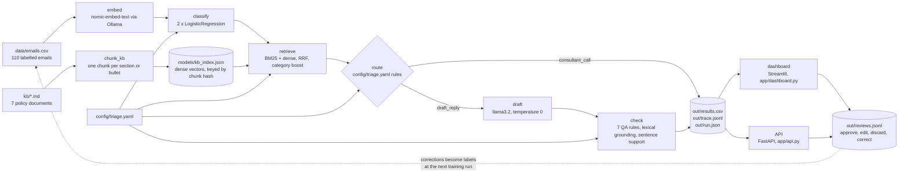

# Architecture

Care Triage is a batch pipeline, a dashboard that reads what the batch wrote, and a small API over the same code. Everything runs on one laptop. Models come from Ollama on localhost. There is no cloud account, no container platform, no queue and no outbound email anywhere in this repo.

## Data flow

The dashed arrow is a manual step. Corrections are logged, nothing retrains itself. The runbook describes how they are folded into the next training run.

## Components

| Stage | Code | Model or method | Output |
|---|---|---|---|
| Embed | `app/classify.py` `embed()` | nomic-embed-text, 768 dimensions, task prefix `classification:` | one unit vector per email |
| Classify | `app/classify.py` | LogisticRegression, C=4, class_weight=balanced, one for 7 categories and one for 3 sentiments | category, sentiment, probabilities, confidence band |
| Retrieve | `app/retrieve.py` | BM25Okapi plus cosine over dense chunk vectors, reciprocal rank fusion with k=60, category boost worth one first place vote | top 4 chunks with both ranks |
| Route | `app/draft.py` `route_rule()` | four rules from `config/triage.yaml`, first match wins | consultant_call or draft_reply, a reason, a short label |
| Draft | `app/draft.py` `draft_reply()` | llama3.2 through Ollama, temperature 0, seed 7, 260 token cap, only the retrieved notes as facts | a reply for a person to read |
| Check | `app/draft.py` `draft_qa()`, `lexical_check()`, `sentence_support()` | deterministic rules, number and directive matching, per sentence cosine against the notes | score 0 to 100, flags, per sentence support |

`app/genai.py` holds the generative steps beyond the draft: per-paragraph relevance grading with one query rewrite (corrective RAG) and the brief with grounded facts; `app/triage.py` composes them in `retrieve_graded()` and `make_brief()`. `app/pipeline.py` runs these in order for every email and writes `out/`. `app/triage.py` runs the same six stages for one email and returns a record shaped like a line of `out/trace.jsonl`; the dashboard's Live triage page draws each stage as it finishes, and the API's `/triage` does the same work. `app/eval_retrieval.py` and `app/classify.py` write the evaluation files in `models/`.

## Where things live

| Path | What | Written by |
|---|---|---|
| `config/triage.yaml` | every threshold, rule and model name | a person |
| `data/emails.csv` | the labelled emails | a person, through `data/make_emails.py` |
| `kb/*.md` | the knowledge base | a person |
| `models/category.joblib`, `models/sentiment.joblib` | the fitted classifiers, refit on all rows | `classify.py` |
| `models/metrics.json`, `models/eval.json` | headline numbers, out-of-fold predictions, folds, confusion | `classify.py` |
| `models/retrieval_eval.json` | hit@k, MRR, misses, low evidence ids | `eval_retrieval.py` |
| `models/kb_index.json` | dense vectors for the chunks | `retrieve.py`, on first use |
| `out/results.csv` | one row per email with every decision | `pipeline.py` |
| `out/trace.jsonl` | one record per email with every stage's output and timing | `pipeline.py` |
| `out/run.json` | run id, versions, config hash, counts, timings | `pipeline.py` |
| `out/reviews.jsonl` | append only review decisions | dashboard and API |

## Caching and invalidation

- The dense index is cached in `models/kb_index.json` under an MD5 of all chunk texts. Editing any file in `kb/` changes the hash, and the next `Retriever()` rebuilds the index. Nothing else needs clearing.
- The dashboard caches the files it reads with `st.cache_data`. A new run means restarting the app or using Streamlit's rerun. The review log cache is cleared by the writer every time a decision is appended.
- The API keeps the retriever and the two classifiers in process memory after first use. Restart it after retraining.
- `out/run.json` carries `config_hash`, a SHA-256 prefix of `config/triage.yaml`. If the hash on the Configuration page and the hash in the last run differ, the numbers on screen were produced under different settings.

## What is deterministic

- Classification, retrieval, routing and every QA rule are deterministic for a given model file and configuration.
- Drafting runs at temperature 0 with a fixed seed, which is repeatable on the same machine and Ollama build but not guaranteed across machines or model updates.
- Embeddings are deterministic for a given model file. Pulling a new version of nomic-embed-text changes the vectors, which changes classification, retrieval and the index hash. Treat a model pull as a retrain.
- Training uses fixed random states for the split, the repeated cross-validation and the out-of-fold folds. Re-running `classify.py` on the same data reproduces `eval.json` to the third decimal place.
